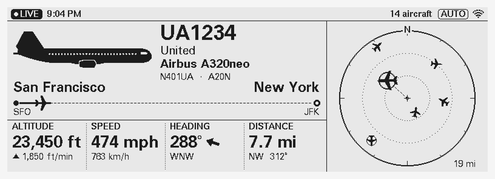
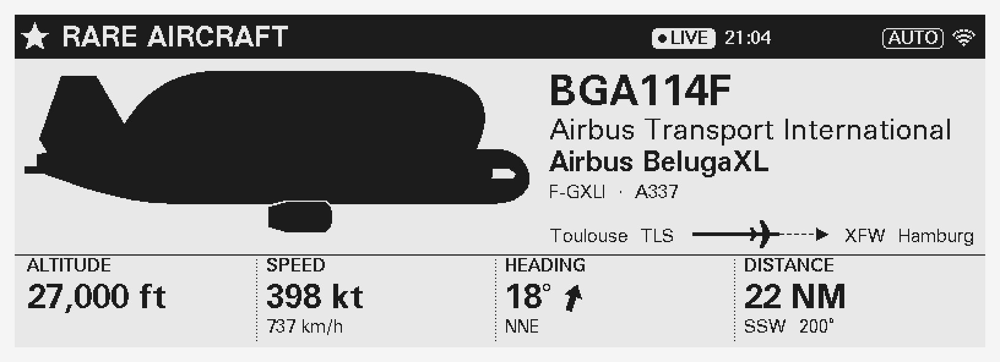
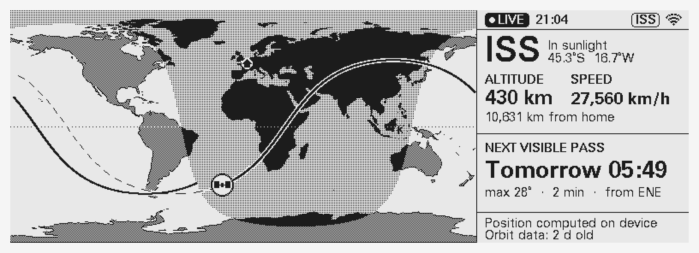
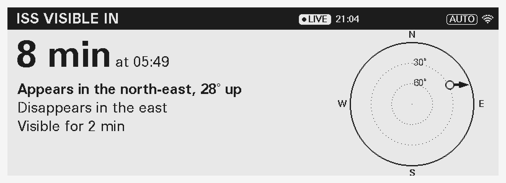
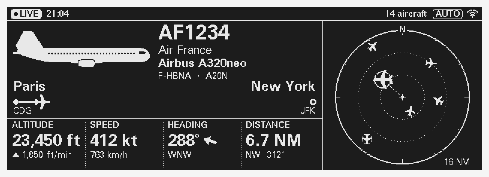
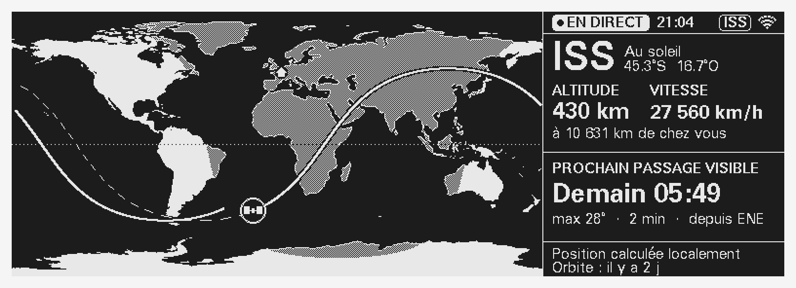

# PlaneSpotter

A desk display that shows what is flying over your home, built on an ESP32-S3
and a 5.79" black-and-white e-paper panel (792 × 272).

- **Closest aircraft, in real time:** model, airline, registration, route
  (city → city with progress), altitude and vertical rate, speed, heading,
  distance and direction from home. It also shows a side-view silhouette
  (63 families, including military) and a mini radar.
- **Rare aircraft take over the screen:** Beluga, BelugaXL, Dreamlifter, A380,
  An-124, B-52, V-22 and any military aircraft. Emergencies (squawk
  7500/7600/7700, or an emergency declared by the crew) always win.
- **ISS mode:** live position on a world map with day/night shading, the
  current orbit, sunlit/shadow state, and the next visible pass.
- **ISS pass alerts:** 10 minutes before the ISS becomes visible from home, a
  countdown says where to look, how high it will rise and where it will
  disappear, with a sky chart. During the pass it shows live direction.
- **One-scan setup from your phone:** scan the QR code on the screen, pick
  your Wi-Fi and type your town. It works on home and office networks,
  including work Wi-Fi that asks for a username (WPA2-Enterprise). Available in
  English and French.
- **Signed over-the-air updates** with automatic rollback.
- **Light or dark theme** (black on white, or white on black), chosen on the
  settings page.
- **A clear offline state:** a hatched "OFFLINE" screen that says why, and
  "LIVE / DELAYED" badges, so old data never looks live.

| | |
|---|---|
|  |  |
|  |  |
|  |  |
|  |  |

These previews are rendered by the firmware's own drawing code (see
[Development](#development)). All silhouettes are in
[docs/silhouettes.png](docs/silhouettes.png).

---

## Hardware

| Part | Notes |
|---|---|
| ESP32-S3-DevKitC-1 **N16R8** | 16 MB flash, 8 MB PSRAM. The partition table uses all 16 MB (two 6 MB update slots) |
| Good Display **GDEY0579T93**, 5.79" 792×272 B/W e-paper | Fast partial refresh (~0.45 s) |
| Good Display **DESPI-C579** adapter | Made for this panel: it has two controllers that both need to be wired. The generic DESPI-C02 does **not** work |
| USB-C cable, 5 V supply | ~80 mA average |
| Optional: a momentary push button | The board's BOOT button works too |

### Wiring

| DESPI-C579 | ESP32-S3 GPIO |
|---|---|
| BUSY | 7 |
| RES | 8 |
| D/C | 9 |
| CS | 10 |
| SDI (MOSI) | 11 |
| SCK | 12 |
| 3.3V / GND | 3V3 / GND |
| Button | GPIO 0 (BOOT) to GND |

To use different pins, change them in [include/config.h](include/config.h).

### Button

| Press | Action |
|---|---|
| Short | Cycle the mode: **Auto** → **Aircraft** → **ISS** |
| Hold 3 s | Open settings (Wi-Fi, town, display options). Press again to close |
| Hold 10 s | Erase all settings and restart in setup mode (a warning appears at 6 s) |

**Auto** shows the closest aircraft, and the ISS map when the sky is quiet.
Rare-aircraft takeovers, emergencies and ISS pass alerts work in every mode.

---

## Build and flash

```bash
python3 -m pip install platformio
```

```bash
pio run -t upload && pio device monitor
```

The first build downloads the ESP32 toolchain (a few hundred MB).

### Setup and settings

1. The screen shows a QR code. Scanning it with a phone camera joins the
   display's own Wi-Fi network (`PlaneSpotter-XXXX`, password shown on screen),
   and the setup page opens by itself.
2. Pick a Wi-Fi network (2.4 GHz). For work networks that ask for a username, a
   username field appears.
3. Type a town. The list of 34,000 towns is stored on the display, so this
   works without internet. It also sets the time zone. Press **Save**.

The display then joins the network, checks that it can reach the internet, and
reports the result on both the phone and the screen. Possible problems are a
wrong password, a network that can't be found (for example 5 GHz only), or
guest Wi-Fi that needs a sign-in page.

Later, **hold the button for 3 seconds** to open the same page, pre-filled. It
covers Wi-Fi, town, language, units, theme, ranges, rare-aircraft level, ISS
alerts, automatic updates and "Check for updates". Because the phone talks to
the display directly, this works on any network, including office networks
that isolate devices. Settings close on a short button press, on "Close
settings", or after 10 idle minutes. Only someone who can see the screen gets
the network password, which is new each time.

Some office networks only let registered devices on. The page shows the
display's MAC address so IT can register it.

### Preparing units to give away

1. Flash each board (`pio run -t upload`) and assemble it.
2. Test it on your own Wi-Fi with the setup page.
3. **Hold the button for 10 seconds** to erase your Wi-Fi and town. The
   display restarts on its setup screen.
4. Unplug it and pack it with a printed quick-start card
   ([docs/quickstart/quickstart.pdf](docs/quickstart/quickstart.pdf): A6,
   English on the front, French on the back).

---

## Where the data comes from

| Data | Source | Notes |
|---|---|---|
| Aircraft positions | [adsb.lol](https://adsb.lol) `/v2/lat/lon/dist` | Fallback: [adsb.fi](https://adsb.fi) open data. Polled every 8 s |
| Route, airline | [adsbdb.com](https://www.adsbdb.com) | Fallback: [hexdb.io](https://hexdb.io) (ICAO codes only). Routes the aircraft clearly isn't flying are hidden |
| Model, family, rarity | [data/aircraft_types.csv](data/aircraft_types.csv), [data/families.csv](data/families.csv) | Built into the firmware |
| Airline names (fallback) | [data/airlines.csv](data/airlines.csv) | Includes military callsign prefixes |
| ISS orbit | [CelesTrak](https://celestrak.org) TLE, refreshed every 12 h | Position, passes and visibility are **computed on the device** (SGP4) |
| Towns and time zones | [GeoNames](https://www.geonames.org) cities > 15,000 people (CC BY 4.0) and the IANA tz database | Built into the firmware, served to the setup page |
| Time | NTP | |

All of these are free community services, so please keep the poll interval
reasonable (`ADSB_POLL_MS`, minimum 5 s).

### Freshness rules

| Data age | Display |
|---|---|
| < 25 s | Black **LIVE** badge |
| 25 s – 2 min | Outlined **DELAYED 40s** badge; data still shown |
| > 2 min | Full-screen **OFFLINE** with a hatched border, the reason (Wi-Fi, flight data service or clock), and the time of the last good data |

The ISS map stays live without Wi-Fi because its position is calculated on the
device. The screen says so, and shows the age of the orbit data. If that data
is older than 14 days, the ISS screen goes offline too.

---

## Customising

- **Rarity:** edit the last column of `data/families.csv`, or add a 4th column
  to a type in `data/aircraft_types.csv`. Then run
  `python3 tools/gen_assets.py`. The thresholds are: "very rare only" ≥ 80,
  "rare & military" ≥ 55, "anything unusual" ≥ 40. Military aircraft get at
  least 65.
- **New aircraft types:** add a line to `data/aircraft_types.csv` (ICAO
  designator, family key, display name) and regenerate.
- **Silhouettes:** they are parametric drawings in
  [tools/silhouettes.py](tools/silhouettes.py). Tweak them, run
  `gen_assets.py` and check `docs/silhouettes.png`.
- **Small towns:** the setup page lists every place with more than 15,000
  people. To add a smaller one, add a line to
  [data/extra_towns.csv](data/extra_towns.csv) (name, state/region, country
  code, coordinates, time zone), run `python3 tools/gen_assets.py`, and flash or
  release.
- **Timings and endpoints:** see [include/config.h](include/config.h).

---

## Over-the-air updates

### How it works

1. Once a day (and on demand from the settings page), the device downloads
   `manifest.json` from `OTA_MANIFEST_URL`.
2. The manifest's **ECDSA P-256 signature** is checked against the public key
   compiled into the firmware. The signature covers the version, size, SHA-256
   and download URL.
3. Only a **newer** version is accepted. A version that was rolled back before
   is never retried.
4. The image is streamed into the inactive OTA slot while being hashed. If the
   hash doesn't match the signed one, the slot is discarded.
5. The device reboots into the new image in *pending verify* state. The new
   firmware must fetch aircraft data successfully within **5 minutes**. If it
   crashes, hangs, reboots or misses that deadline, the bootloader **rolls
   back** to the previous version. Either way, the screen then shows
   "Updated to X" or "Update failed, back on X".

### Releasing a version

```bash
python3 tools/ota_keygen.py
```

Run this once to create `keys/ota_private.pem`, which is gitignored. **Back it
up**: devices only accept updates signed with this key. It also writes
`include/ota_pubkey.h`. (A key pair was already generated for this checkout.)

Updates come from **GitHub Releases**. Set `GITHUB_REPO` in
`include/config.h` (for example `"jane/planespotter"`) **before flashing the
units you give away**, because that is where they will look for updates. The
repository must be public so the displays can download releases without
logging in. Until `GITHUB_REPO` is set, update checks are skipped.

For each release, bump the number in `VERSION`, then run:

```bash
python3 tools/release.py --notes "What changed"
```

This builds, signs, and creates the GitHub release with `firmware-X.Y.Z.bin`
and `manifest.json`. It uses the GitHub CLI (`gh auth login` once). Without the
CLI, it prints the two files to upload by hand. Displays install the update
within a day.

Hardware-level protection (ESP32 Secure Boot v2 and flash encryption) is
possible on top of this, but it burns eFuses irreversibly. It is left out on
purpose.

---

## Development

```bash
make -C test/host test
```

This runs the unit tests and checks SGP4 and pass prediction against
python-sgp4 and Skyfield. It needs `pip install sgp4 skyfield pillow`.

```bash
make -C test/host previews
```

This renders every screen in both languages and both themes to `docs/previews/`.

```bash
python3 test/host/mock_device.py
```

This serves the setup page with a fake API and simulated networks: open
`http://localhost:8080/`. Pass `settings` as a second argument to see the
settings version.

```bash
python3 tools/gen_assets.py
```

This regenerates `src/generated/` from `data/` (it downloads Natural Earth and
GeoNames data on the first run).

### Layout

```
src/core/       pure C++ (no Arduino): SGP4, ISS passes, geodesy, rarity & selection, text, i18n
src/ui/         view models + screen renderers (Adafruit-GFX; also built on the host)
src/net/        HTTPS, data feeds, setup/settings portal (own Wi-Fi + captive DNS), signed OTA
src/hw/         e-paper driver and refresh policy
src/app/        settings storage, hooks for the web server
src/web/        the phone page (setup and settings, offline town search)
src/generated/  tables, silhouettes, world map (from tools/gen_assets.py)
tools/          asset and town-list generators, key generation, signing, release
test/host/      host unit tests, astro cross-checks, screen previews, mock device
```

### Notes and limitations

- E-paper refreshes are rate-limited (at most every ~9 s, only when something
  visible changes) with a full refresh every 30 partial ones to prevent
  ghosting.
- Route data comes from crowd-sourced databases and can be wrong or missing.
  The display shows "Route unknown" rather than a route the aircraft is
  obviously not flying.
- The ISS visibility test uses a cylindrical Earth-shadow model and civil
  twilight (Sun below −6°). Its timings match Skyfield to within seconds.
  Brightness (magnitude) is not predicted.
- The hardware hasn't been tested on a real panel yet. Expect to fine-tune
  pins, SPI speed and refresh timing on the first boot.
